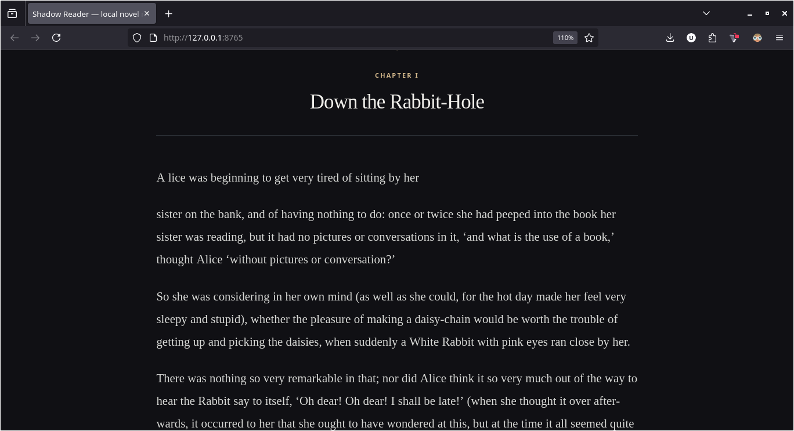
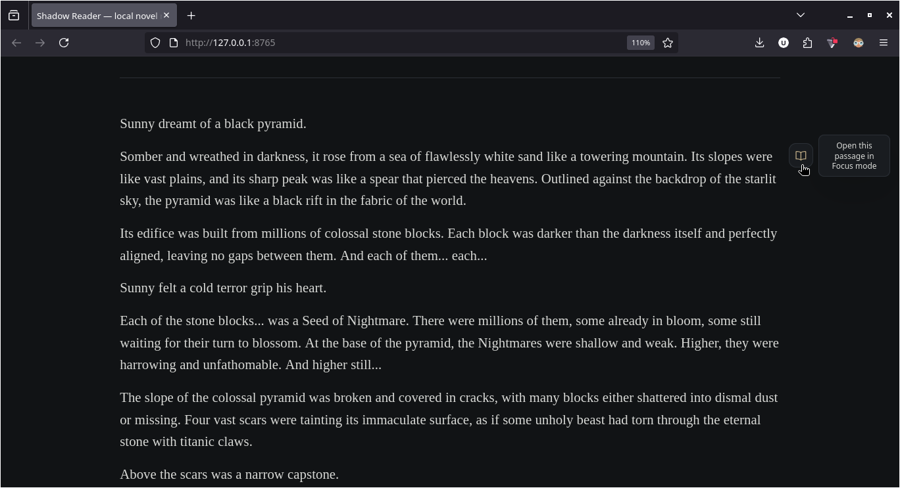
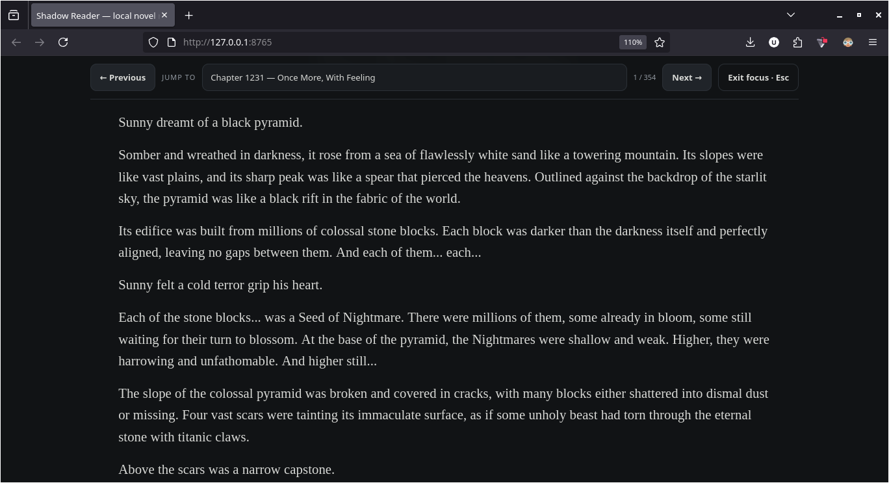
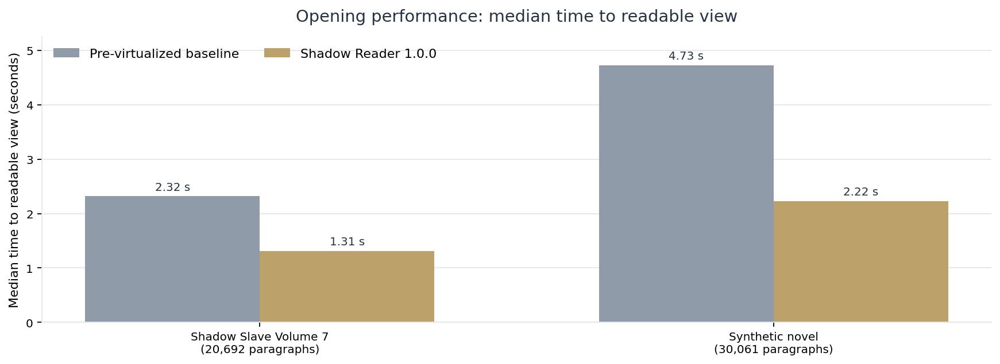
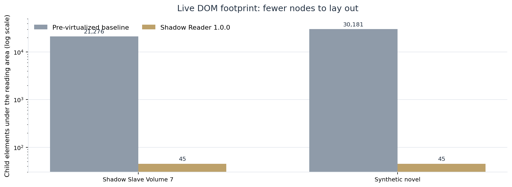
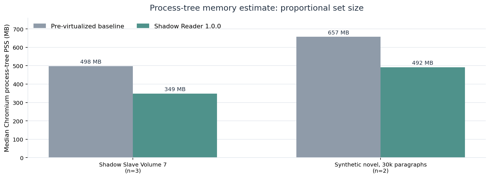
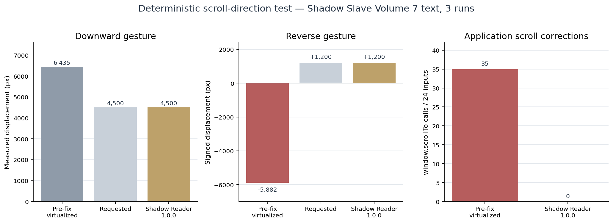

<div align="center">
  
  <h1>Shadow Reader</h1>
  <p><strong><em>An invaluable companion on your reading journey.</em></strong></p>
  <p><strong>Not a reflection. Not an imitation. A companion.</strong><br>
  A presence that follows, helps, remembers and stays.</p>
  <p>A calm, private reading space for long novels and text-based PDFs.<br>
  Settle into the story, move between chapters, and pick up where you left off.</p>
  <p><a href="https://github.com/nameless-traveler/Shadow-Reader/releases/latest/download/Shadow-Reader-1.0.0.zip"><strong>↓ Download for Debian 13 (Trixie)</strong></a></p>
  <p><a href="https://github.com/nameless-traveler/Shadow-Reader/releases">Releases</a> · <a href="#install-and-run">Get started</a> · <a href="#features">Explore features</a></p>
</div>

<p align="center">
  <a href="https://github.com/nameless-traveler/Shadow-Reader/releases/latest"></a>
  <a href="LICENSE"></a>
  
</p>

---

## Why Shadow Reader

**A local, distraction-free reader for long novels and text-based PDFs.** Shadow Reader reflows selectable PDF text into a comfortable reading layout, detects chapter headings, and provides Normal and Focus reading modes. It is designed for long books and keeps your reading progress on your own computer.

Explore [features](#features), [installation](#install-and-run), [performance](#performance-benchmarks), [testing](tests/TESTING.md), [release notes](RELEASE_NOTES.md), and [engineering reports](docs/reports/README.md).


[Performance report](PERFORMANCE_BENCHMARK.pdf) · [Benchmark data and charts](benchmarks/) · [Additional reports](docs/reports/README.md)


---

## Contents

- [Features](#features)
- [See Focus Here in action](#see-focus-here-in-action)
- [Platform and dependencies](#platform-and-dependencies)
- [Install and run](#install-and-run)
- [Reading a book](#reading-a-book)
- [Where reading progress is saved](#where-reading-progress-is-saved)
- [PDF and chapter-detection limitations](#pdf-and-chapter-detection-limitations)
- [Performance benchmarks](#performance-benchmarks)
- [Test environment](#test-environment)
- [Run the test suite](#run-the-test-suite)
- [Troubleshooting](#troubleshooting)
- [Project files](#project-files)
- [License](#license)

## Features

- **Normal mode:** read the novel as one continuous, reflowed document.
- **Focus mode:** read one detected chapter at a time, navigate with Previous/Next, or jump directly from the chapter menu.
- **Focus Here:** in Normal mode, reveal the small open-book control by moving the pointer into the right reading margin. It opens Focus mode at the passage you are reading rather than restarting the chapter.
- **Chapter detection:** supports explicit Chapter/Ch and Letter headings, Arabic and Roman numerals, common written numbers, numbered web-novel titles, classic numbered headings, and named sections such as Prologue and Epilogue. Titles may wrap across lines or appear separately from the chapter number.
- **Long-book virtualization:** books with at least 1,600 source paragraphs render a small window around the current position rather than keeping every paragraph in the live DOM. Very long Focus-mode chapters use virtualization as well.
- **Full-book search:** `Ctrl+F` opens Shadow Reader's search, which can find text in parts of a virtualized book that are not currently rendered. Selecting a result navigates to it.
- **Continue Reading:** save progress independently for each book and choose Continue reading or Start from the beginning when reopening it.
- **Mode-independent progress:** the furthest reading position is tracked against the source text, so opening the same passage in Focus mode does not count it a second time.
- **Reader controls:** S/M/L font sizes, Tight/Normal/Loose paragraph spacing, Narrow/Medium/Wide reading widths, and Night/Sepia/Paper themes.
- **Accessibility:** keyboard navigation in Focus mode, a keyboard-accessible Focus Here control when relevant, a keyboard-contained resume prompt, and respect for reduced-motion preferences.
- **Local processing:** PDF text extraction and reading take place on your computer. There are no analytics or third-party requests.

## See Focus Here in action

Shadow Reader provides a continuous reading experience in Normal mode and a chapter-by-chapter experience in Focus mode. You can switch directly from your current reading position without having to restart the chapter.

### 1. Normal mode

Read the entire book as one continuous document. While reading, move your pointer toward the right-side margin beside the reading guide to reveal the Focus Here control.



### 2. Reveal Focus Here

When the control appears, click the small open-book icon to open the current passage in Focus mode.



### 3. Focus mode

Focus mode presents the detected chapter with dedicated navigation controls. Move between chapters using Previous and Next, jump directly using the chapter selector, or press Esc to return to Normal mode.



## Platform and dependencies

### Supported target

- **Target operating system:** Debian GNU/Linux 13 (Trixie).
- **Test status:** the application has been used on Debian 13 Trixie with Firefox. Automated browser tests and performance measurements were run in a separate Debian 13 test container with headless Chromium; see [Test environment](#test-environment) for the exact details.
- **Recommended browser:** Firefox. A modern desktop browser is needed to use the reader.

### Required to run the application

| Dependency | Why it is needed | Installed by `run.sh`? |
|---|---|---|
| Python 3 (3.10 or newer) | Runs the local HTTP server. The app uses Python's standard library; no Python packages are needed for normal use. | No. Debian 13 already provides Python 3. |
| Poppler `pdftotext` (`poppler-utils` package) | Extracts selectable text from PDFs. | **Offered interactively if missing.** See below. |
| A desktop browser | Displays the reader UI. Firefox is recommended. | No. Install/use your preferred browser separately. |

**Node.js, `pip`, Playwright, and `psutil` are not required to read books.** Node.js and Playwright are only needed for the optional development/test workflows. `psutil` is optional for the benchmark's process-memory measurements.

### What `./run.sh` does automatically

The launcher is deliberately small and does not install a large dependency stack:

1. It checks whether the `pdftotext` command is available.
2. If it is missing, it asks whether you want to install Poppler.
3. If you answer **yes** and `sudo` is available, it runs `sudo apt update` and `sudo apt install -y poppler-utils`.
4. If you decline, the server still starts and plain-text `.txt` files remain usable; PDF import will not work until Poppler is installed.
5. It starts `server.py` with Python 3 and attempts to open your default browser at `http://127.0.0.1:8765/`.

It does **not** install Python packages, Node.js, Firefox, or Chromium. Installing Poppler requires an internet connection and permission to use `sudo` unless you install it manually as an administrator.

## Install and run

### Option A — Download the ready-to-run ZIP (recommended)

1. Download the ZIP using the direct-download link near the top of this page.
2. Extract the ZIP. Open the extracted project directory — the directory containing `run.sh`.
3. Open a terminal in that directory.
4. Run:

   ```sh
   ./run.sh
   ```

5. If asked to install Poppler for PDF support, type `y` and press Enter. Otherwise, type `n` to continue with `.txt` files only.
6. Your browser should open the reader. If it does not, open **http://127.0.0.1:8765/** manually.
7. Click **Open a PDF** and choose a book. You can also open a plain `.txt` file.

Keep the terminal open while you read. To stop the local server, return to that terminal and press **Ctrl+C**.

### Option B — Run from a Git clone

After cloning the repository, open a terminal in the repository's project directory (the directory containing `run.sh`) and run:

```sh
./run.sh
```

If your downloaded/extracted file does not preserve executable permissions, run this once first:

```sh
chmod +x run.sh
./run.sh
```

### If Poppler is not installed

The launcher asks before installing it. You can also install PDF support manually:

```sh
sudo apt update
sudo apt install -y poppler-utils
```

To run the reader without Poppler, decline the install prompt. Plain-text files will still work.

### If the default port is already in use

Use a different port, for example:

```sh
SHADOW_READER_PORT=8766 ./run.sh
```

The default port is `8765`. The older `QUIET_READER_PORT` environment variable is still accepted for compatibility, but `SHADOW_READER_PORT` takes precedence.

## Reading a book

1. Click **Open a PDF** and choose your book. The source PDF is not modified.
2. Read in Normal mode, or enter Focus mode using one of the Focus mode controls.
3. In Focus mode, use **Previous**, **Next**, the chapter menu, or the left/right arrow keys to navigate detected chapters. Press **Esc** to leave Focus mode.
4. To enter Focus mode from the middle of a long passage, move the pointer toward the right-side margin beside the reading guide and choose the small open-book control when it appears.
5. Press `Ctrl+F` to search the full extracted text, including paragraphs that are not currently mounted by virtualization.
6. When reopening the same book, choose **Continue reading** to restore the saved position or **Start from the beginning** to reset that book's position and progress.

The browser intentionally does not reopen a local file automatically. You must select the same PDF again; Shadow Reader can then match it to its saved reading state.

## Where reading progress is saved

Reading progress and display preferences are stored in your browser's local storage on this computer. Shadow Reader stores a text fingerprint and reading-position metadata—not a copy of the book.

Use the same address every time: **`http://127.0.0.1:8765/`** (or the alternate port you configured). `http://localhost:8765/` and `http://127.0.0.1:8765/` are different browser storage origins. Switching between them can make saved progress appear to be missing. Clearing that site's data also deletes its saved progress and preferences.

## PDF and chapter-detection limitations

- The PDF must contain a selectable text layer. Scanned/image-only PDFs need OCR before Shadow Reader can extract their words; OCR is not built in.
- Shadow Reader is a reflowed reading view, **not a page-faithful PDF renderer**. It is designed for prose and novels, not for preserving multi-column layouts, tables, equations, footnotes, illustrations, or exact page numbers.
- Chapter detection uses cautious heuristics to avoid treating page numbers and running headers as chapters. An unusual heading layout can still be missed, and a detected list may need checking against the source PDF.
- A known ambiguity is a short, unpunctuated number followed by a title. If the same title repeats in that form at least four times, it is treated as a likely running page header. This prevents the false positives previously seen with *Alice's Adventures in Wonderland*, but repeated legitimate headings in that exact format may also be suppressed. Explicit forms such as `Chapter 1`, `1. The Beginning`, or a Roman numeral are easier to identify reliably.
- The application accepts uploads up to **80 MB**. PDF extraction is stopped if output exceeds **25,000,000 UTF-8 bytes** or takes longer than **150 seconds**. Upload reading has a **60-second** timeout.
- Virtualization keeps the live DOM small, but the extracted book text and mapping metadata remain in JavaScript memory. Lower DOM count does not guarantee lower total memory use in every browser or workload.

## Performance benchmarks

The repository includes a four-chart PDF report, chart images, raw CSV trial observations, environment metadata, and the benchmark script. The comparisons below are **project-run tests**, not a third-party certification or an official browser-benchmark score.

### Summary of measured results

| Workload / metric | Earlier baseline | Shadow Reader 1.0.0 | Observed difference |
|---|---:|---:|---:|
| Shadow Slave Volume 7 text: median time to readable view | 2,316.4 ms | 1,310.5 ms | 43.4% lower |
| Synthetic 30,000-paragraph text: median time to readable view | 4,726.5 ms | 2,224.8 ms | 52.9% lower |
| Shadow Slave Volume 7 reader-area DOM elements | 21,276 | 45 | 99.8% fewer |
| Synthetic 30,000-paragraph reader-area DOM elements | 30,181 | 45 | 99.85% fewer |
| Shadow Slave Volume 7 Chromium process-tree PSS | 497.8 MB | 348.6 MB | 30.0% lower |
| Synthetic 30,000-paragraph Chromium process-tree PSS | 657.2 MB | 492.0 MB | 25.1% lower |

The opening-time comparison used three fresh-browser trials per build for Shadow Slave Volume 7 and two trials per build for the synthetic 30,000-paragraph workload. These sample sizes are small; treat the results as directional, not as statistically established guarantees. The comparison measures the combined difference between the pre-virtualization build and release 1.0.0, not the isolated effect of a single code change.

### Charts

**Time from text upload to readable view**



**Live elements under the reading area**



**Chromium process-tree proportional set size (PSS)**



**Scroll displacement and application-issued corrections**



### What the scroll result means

A deterministic browser test requested 4,500 pixels of downward movement, followed by 1,200 pixels upward. The pre-scroll-fix virtualized build overshot the requested downward distance and moved in the wrong direction during the reverse input. The release matched the requested directional displacement and issued zero application `window.scrollTo()` corrections during ordinary scrolling in each of three Shadow Slave Volume 7 test trials.

This verifies **scroll-position correctness in a scripted test**. It does not measure physical touchpad inertia, perceived smoothness, native Firefox frame rate, or display refresh rate.

### Benchmark test environment

The automated performance measurements were collected in this separate, containerized environment—not on the target laptop:

| Component | Recorded environment |
|---|---|
| Operating system | Debian GNU/Linux 13 (Trixie), x86_64, containerized; kernel 6.18.55 |
| CPU | AMD EPYC 9V74 virtual CPU; 5 vCPUs available to the test process |
| Memory / swap | 5.8 GiB visible RAM; 0 B swap |
| Python | 3.13.5 |
| Node.js | v22.16.0 |
| Browser | Headless Chromium 144.0.7559.96 (Debian build) |
| Python Playwright | 1.57.0 |
| Poppler `pdftotext` | 25.06.0 |
| Browser viewport | 1366 × 768 CSS pixels |
| Source workload | Shadow Slave Volume 7 extracted locally to UTF-8 text (20,692 paragraphs); generated 30,000-paragraph and 8,000-paragraph stress texts |

**Important limits:** the machine above is not the target computer. The automated tests used headless Chromium and scripted wheel events, not Firefox's GUI or a physical touchpad. Process-tree PSS is an estimate across Chromium and its child processes; it is not a direct Firefox memory measurement. A 30,000-paragraph run at 4× CPU throttling did not finish within the automation time budget and is inconclusive. Speedometer 3.1 was not run because the benchmark host could not reach its site. There is no official third-party score or claim of a universal FPS improvement.

For the full charts and raw observations, see [`PERFORMANCE_BENCHMARK.pdf`](PERFORMANCE_BENCHMARK.pdf), [`benchmarks/benchmark-results.csv`](benchmarks/benchmark-results.csv), [`benchmarks/environment.json`](benchmarks/environment.json), and [`benchmarks/METHODS_AND_LIMITATIONS.md`](benchmarks/METHODS_AND_LIMITATIONS.md).

## Test environment

Keep the application runtime requirements separate from the optional test tools:

- **Application target tested:** Debian GNU/Linux 13 (Trixie), using Firefox during manual use.
- **Automated UI tests:** Debian 13 container, headless Chromium, Python Playwright. These confirm application interactions but are not equivalent to native Firefox/touchpad tests.
- **GitHub Actions CI:** Lightweight regression tests run automatically on pushes to `main` and pull requests, using GitHub-hosted Ubuntu runners with Node.js 22 and Python 3.13. This workflow validates the regression suite but does not replace testing on the supported Debian 13 target.
- **Benchmark measurements:** the container environment detailed above (AMD EPYC virtual CPU, 5 vCPUs, 5.8 GiB visible RAM, Chromium 144, 1366 × 768 viewport).
- **Full-novel parser corpus:** *Alice's Adventures in Wonderland* (12 chapters), Shadow Slave Volume 6 (170 chapters), and Shadow Slave Volume 7 (354 chapters). These PDFs are test inputs and are **not included** in the source/release archive. The standard generated tests run without them; exact whole-document checks require you to supply locally owned copies and extract their text.

## Run the test suite

The following tools are for development and testing only. They are **not required** for ordinary reading.

### 1. Lightweight tests

Requirements: Node.js for `.cjs` scripts and Python 3 for the server/API test. The recorded test environment used Node.js 22.16.0 and Python 3.13.5.

If Node.js is not installed, install Debian’s package first:

```sh
sudo apt update
sudo apt install -y nodejs
```

From the directory containing `run.sh`, run:

```sh
node tests/parser-regression.cjs
node tests/resume-feature-regression.cjs
node tests/focus-here-feature-regression.cjs
python3 tests/server-api-regression.py
python3 tests/release-branding-regression.py
```

The parser command runs the bundled heading-format fixtures and generated cases. The full-document chapter-count/title assertions require the three text files described in [`tests/TESTING.md`](tests/TESTING.md); those novels are not distributed with the project.

### Last recorded regression results

These are the results recorded for the release source, not a promise that every machine will reproduce identical timings:

| Test group | Recorded result |
|---|---|
| Parser fixtures and generated cases | 293 groups without the optional full-book text corpus; 296 groups when all three full-book text files are supplied |
| Continue Reading and progress checks | 27 passed |
| Focus Here feature checks | 10 passed |
| Branding and port-compatibility checks | 10 passed |
| Local server/API checks | 12 passed |
| Browser smoke tests | Passed in headless Chromium for performance tracking, virtualization, search, resume, Focus Here, and touchpad-like scrolling |

The browser smoke tests use a generated or supplied text fixture in the real reader UI. They are not a replacement for a manual Firefox test with a physical touchpad.

### 2. Browser interaction tests (optional)

These tests use Playwright with Chromium. On Debian, a virtual environment avoids changing system Python packages:

```sh
sudo apt update
sudo apt install -y python3-venv
python3 -m venv .venv
. .venv/bin/activate
python -m pip install playwright
python -m playwright install chromium
```

Then run:

```sh
python3 tests/performance-browser-smoke.py
python3 tests/virtualization-browser-smoke.py
python3 tests/focus-here-browser-smoke.py
python3 tests/resume-browser-smoke.py
python3 tests/touchpad-scroll-behavior.py
```

The browser tests use generated book text by default. To test Focus Here and Continue Reading against a full PDF, pass the PDF path as shown in [`tests/TESTING.md`](tests/TESTING.md). Poppler must be installed for those optional PDF-based checks.

### 3. Re-run the comparative benchmark

The included benchmark script requires Playwright and a local Chromium executable. Install `psutil` as an optional dependency to collect Linux process-tree RSS/PSS measurements:

```sh
python -m pip install psutil
```

The comparison also requires a **separate baseline HTML file** from the earlier pre-virtualized build; this release archive contains the candidate build, not that historical source. With paths to the baseline HTML, current `index.html`, and a locally extracted UTF-8 text file, run:

```sh
python3 benchmarks/run_browser_benchmark.py \
  --baseline-index /path/to/baseline/shadow-reader/index.html \
  --candidate-index ./index.html \
  --text-file /path/to/novel.txt \
  --runs 3 \
  --output-dir ./benchmark-output
```

Use the same source text, viewport, browser version, and CPU load for both builds. Run CPU-throttled tests separately, for example with `--cpu-throttle 2`. The script saves raw JSON and a summary CSV. It sends no novel text to a remote service.

For exact test coverage, known limitations, and additional full-text test commands, see [`tests/TESTING.md`](tests/TESTING.md).

## Troubleshooting

| Problem | What to try |
|---|---|
| The browser did not open automatically | Open `http://127.0.0.1:8765/` manually while `run.sh` is still running. |
| PDF import says Poppler is missing | Run `sudo apt update && sudo apt install -y poppler-utils`, then restart `./run.sh`. |
| The page says the port is already in use | Start with `SHADOW_READER_PORT=8766 ./run.sh` and open `http://127.0.0.1:8766/`. |
| Saved progress seems missing | Use the exact same URL/origin and browser profile used previously. Check whether site data was cleared. |
| The chapter list is incomplete or has false positives | Check the PDF's text layer and heading format. Normal mode remains available even if chapter detection is imperfect. |
| The PDF opens but words or paragraphs are merged strangely | Shadow Reader relies on the PDF's text layout. Scanned pages, multi-column documents, missing indentation, and unusual line breaks may need OCR or preprocessing. |
| `./run.sh` says permission denied | Run `chmod +x run.sh`, then `./run.sh`; alternatively run `sh run.sh`. |


## Project files

```text
Shadow-Reader/
├── .github/
│   └── workflows/
│       └── ci.yml
│
├── .gitignore
├── LICENSE
├── README.md
├── RELEASE_NOTES.md
├── PERFORMANCE_BENCHMARK.pdf
├── assets/
│   └── shadow-reader-logo.png
├── index.html
├── server.py
├── run.sh
├── benchmarks/
│   ├── README.md
│   ├── METHODS_AND_LIMITATIONS.md
│   ├── benchmark-results.csv
│   ├── environment.json
│   ├── run_browser_benchmark.py
│   └── charts/
│       ├── opening-time.png
│       ├── dom-footprint.png
│       ├── process-tree-pss.png
│       └── scroll-correctness.png
│
├── docs/
│   ├── reports/
│   │   ├── README.md
│   │   ├── review-and-test-report.md
│   │   ├── touchpad-scroll-fix-report.md
│   │   └── virtualization-performance-report.md
│   │
│   └── screenshots/
│       ├── 01-normal-mode.png
│       ├── 02-focus-here-hover.png
│       └── 03-focus-mode.png
│
└── tests/
    ├── TESTING.md
    ├── source-style-manifest.json
    ├── parser-regression.cjs
    ├── resume-feature-regression.cjs
    ├── focus-here-feature-regression.cjs
    ├── server-api-regression.py
    ├── release-branding-regression.py
    ├── performance-browser-smoke.py
    ├── virtualization-browser-smoke.py
    ├── focus-here-browser-smoke.py
    ├── resume-browser-smoke.py
    └── touchpad-scroll-behavior.py
```

## License

Shadow Reader is licensed under the **Apache License 2.0**. See [`LICENSE`](LICENSE) for the full license text.

Copyright © 2026 **nameless-traveler**.

The Apache 2.0 license permits use, modification, and redistribution subject to its terms. If you redistribute the project, include the license and preserve the required notices. The license does not grant permission to use the project's name or trademarks as endorsements.

Third-party tools and libraries, if added by a user or used in a testing environment, remain subject to their own licenses.
